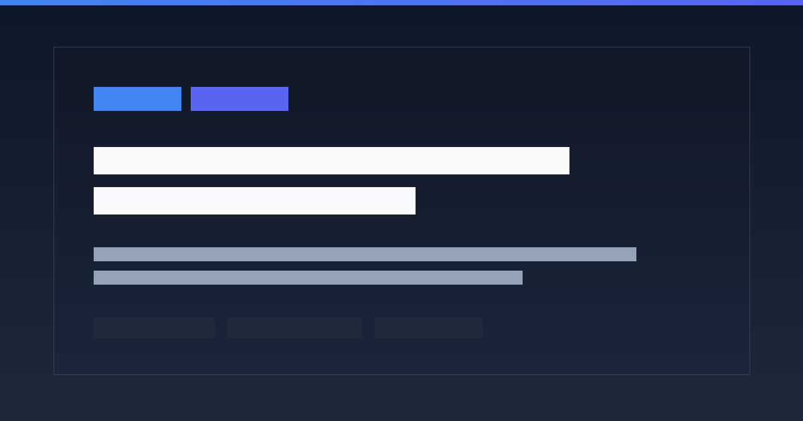

# Google Classroom to Discord Notifier 📢

Google Classroom の投稿（お知らせ・課題・授業資料）を定期的に検知し、Discord チャンネルへ視認性の高いリッチ Embed 形式で自動通知するシステムです。

学校から配布された Google Workspace for Education アカウントに対応しており、複数のクラスを個別の Discord Webhook やメンション（ロール / ユーザー / @everyone）で柔軟にルーティング・管理できます。



---

## 🌟 主な機能

- **3種類の投稿タイプに完全対応**:
  - 📢 **お知らせ（Announcements）**: 本文・添付リンク・投稿者を表示
  - 📝 **課題（CourseWork）**: 提出期限（JST日本標準時自動変換）・配点・説明・添付ファイルを明記
  - 📚 **授業資料（CourseWorkMaterials）**: 配布資料タイトルやリンクを整理して通知
- **視認性に優れた Discord Embed 表示**:
  - 投稿種別ごとのカラーリング（Google Blue・Google Red・Google Green）
  - Classroom 投稿への直接リンク（`alternateLink`）ボタン付き
  - クライアント時間と自動同期する Discord タイムスタンプ対応
- **きめ細やかな複数クラス管理**:
  - クラス（コース）ごとに異なる Discord チャンネル（Webhook）やメンション先（`<@&ロールID>` 等）を設定可能
  - 設定が空の場合は参加中の全アクティブコースを自動検出
- **学校アカウント（Google Workspace for Education）対応**:
  - 管理者によるドメイン委任が不要な OAuth 2.0 デスクトップクライアント方式を採用
  - リフレッシュトークンによる自動更新で、サーバー上での無期限・無人運転が可能
- **Docker Compose 一元管理 & 堅牢な防御的設計**:
  - `compose.yaml` による完全コンテナ化（Portainer CE 監視対応、自動再起動 `unless-stopped`）
  - コンテナ内非rootユーザー（`appuser`）実行によるセキュリティ保護
  - 初回同期モード（`INITIAL_SYNC_MARK_AS_READ`）により、導入初回の過去投稿爆撃（大量スパム）を自動防止
  - クロスプラットフォーム対応の排他ファイルロックによるプロセス多重起動防止
  - SQLite WAL モードによる確実な既読・重複管理
  - Docker 停止シグナル（SIGTERM）に対する Graceful Shutdown（即時・安全な停止）
  - Discord API レートリミット（429）および Google API 一時的エラー（5xx）に対する自動待機・指数バックオフリトライ

---

## 🛠 技術スタック

- **実行環境**: Docker / Docker Compose (Ubuntu Server)
- **管理コンソール**: Portainer CE
- **言語**: Python 3.12+ (軽量 slim イメージ)
- **Google API**: `google-api-python-client`, `google-auth-oauthlib`, `google-auth-httplib2`
- **データ検証**: `pydantic` v2
- **データベース**: SQLite 3 (WAL mode)
- **HTTP / Webhook**: `requests`
- **リント / テスト**: `ruff`, `pytest`, `pytest-mock`
- **CI/CD**: GitHub Actions

---

## 📁 ディレクトリ構成

```text
.
├── .github/
│   └── workflows/
│       └── main.yml              # CI/CD: 構文チェック・型チェック・自動テスト
├── assets/
│   └── ogp.png                   # OGPソーシャルカード画像 (1200x630)
├── config/
│   └── courses.example.json      # クラス個別設定のサンプル
├── src/
│   ├── cli.py                    # CLI コマンド（auth, list-courses, test-notify, run）
│   ├── config.py                 # 環境変数・設定ファイル読込と Pydantic バリデーション
│   ├── auth.py                   # Google OAuth 2.0 認証フロー
│   ├── classroom.py              # Google Classroom API クライアント（IDOR認可チェック・JST変換付き）
│   ├── discord.py                # Discord Webhook 送信クライアント（Embed整形・レートリミット対策）
│   ├── storage.py                # SQLite 既読・状態管理
│   ├── notifier.py               # ポーリング・差分検知オーケストレーター（Graceful Shutdown対応）
│   └── utils/
│       ├── lock.py               # プロセス多重起動防止ロック
│       └── logger.py             # 機密情報マスク機能付きログ設定
├── tests/                        # ユニットテスト一式
├── .dockerignore                 # Docker ビルド除外設定
├── .env.example                  # 環境変数設定サンプル
├── .gitignore                    # Git 除外設定
├── compose.yaml                  # Docker Compose 構成定義
├── Dockerfile                    # マルチステージ軽量 Dockerfile（非root実行）
├── LICENSE                       # MIT License
├── pyproject.toml                # プロジェクトメタデータ・ツール設定
├── requirements.txt              # 本番依存パッケージ
├── requirements-dev.txt          # 開発・テスト用パッケージ
├── README.md                     # 本ドキュメント
└── DEPLOYMENT_GUIDE.md           # デプロイ・手動オペレーション手順書
```

---

## 🚀 クイックスタート（Docker環境）

### 1. リポジトリのクローンと環境準備

```bash
git clone https://github.com/zyuuuukak1n/discord-classroom-notifier.git
cd discord-classroom-notifier
```

### 2. 環境変数設定

`.env.example` をコピーして `.env` を作成し、Discord Webhook URL を設定します。

```bash
cp .env.example .env
vi .env
```

### 3. Google OAuth 認証情報の配置

1. [Google Cloud Console](https://console.cloud.google.com/) でプロジェクトを作成し、**Google Classroom API** を有効化します。
2. OAuth 同意画面を設定し（テストユーザーに対象の学校アカウントを追加）、デスクトップアプリ形式の OAuth クライアント ID を作成します。
3. ダウンロードした JSON を `credentials.json` として配置します。
4. 初回認証を実行して `token.json` を生成します（手元のローカル PC での実行を推奨）：

```bash
python -m venv .venv
source .venv/bin/activate  # Windows: .venv\Scripts\activate
pip install -r requirements.txt
python -m src.cli auth
```

生成された `token.json` をサーバーのプロジェクトディレクトリに配置します。

### 4. Docker Compose での起動

```bash
# データおよびログ保存用ディレクトリの作成
mkdir -p data logs

# ビルド & バックグラウンド起動
docker compose up -d --build

# ログ確認
docker compose logs -f
```

---

## 🧪 テストの実行

```bash
# 仮想環境有効化後
ruff check .
ruff format --check .
pytest -v
```

---

## 📖 本番環境デプロイ手順

Portainer CE による監視設定やサーバー運用の詳細手順は、**[DEPLOYMENT_GUIDE.md](DEPLOYMENT_GUIDE.md)** をご覧ください。

---

## 📄 ライセンス

MIT License (c) 2026 じゅーかきん
